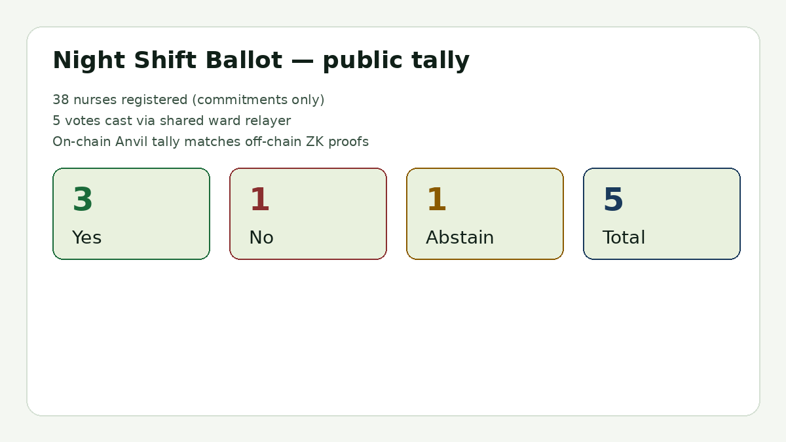
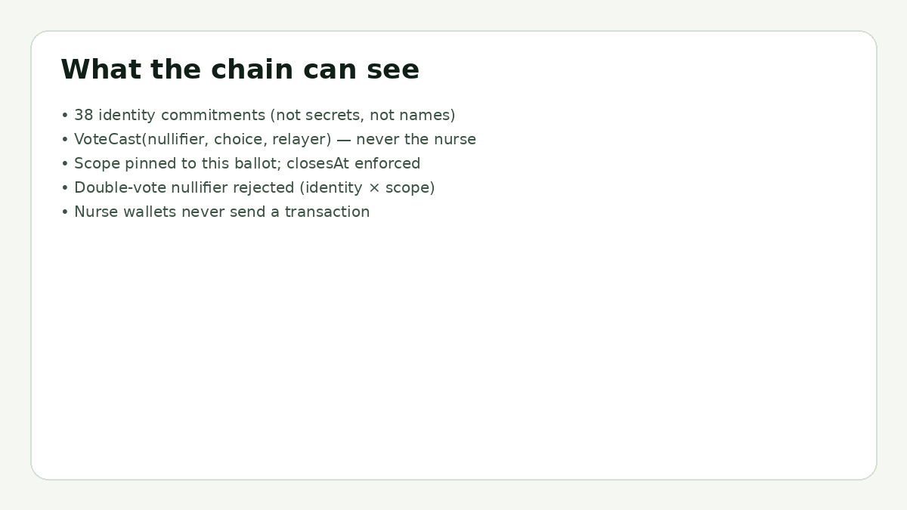
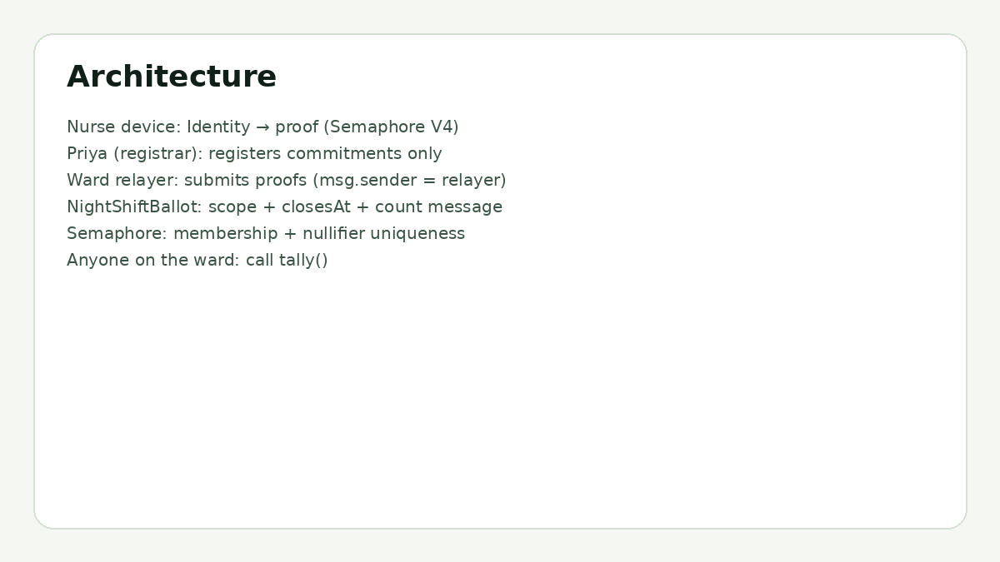

# Night Shift Ballot

**Devcon 8 · Build Battle 3 — "Prove It, Don't Reveal It"**
*Count Every Vote, Name No Voter*

Anonymous staff vote for Priya's 38-nurse night shift. Built by **Shyam Desigan** (Cubiczan LLC).



**Demo video:** [docs/demo.mp4](docs/demo.mp4)

## The problem (from the brief)

Priya represents 38 nurses. They need to vote on filing a complaint about unsafe staffing. A show of hands named everyone in front of a supervisor. A group-chat poll put every name next to every answer.

They need a vote where:

1. **Only the 38 can vote**
2. **Each of them once**
3. **Nobody (including Priya) can tell who chose what**
4. **Anyone on the ward can check the result**

## What we built

`NightShiftBallot` + Semaphore V4.

| Requirement | How |
|---|---|
| Only the 38 | Priya (registrar) adds **identity commitments** to a Semaphore group. Max 38. Secrets never leave each nurse's device. |
| Once each | Semaphore nullifier is unique per identity × **scope**. Scope is pinned to this ballot's id. Contract also tracks nullifiers. |
| Nobody learns who | Proof carries the choice as its `message`. A shared **ward relayer** submits the proof — the nurse's wallet never appears on chain. |
| Anyone can check | Public `tally()` returns yes / no / abstain / total / closed. |
| Contract still does the rest | Pins `proof.scope == ballotScope`, enforces `closesAt`, counts the choice in `proof.message`. Semaphore alone doesn't do those three. |



### Tooling (as specified)

- Semaphore V4 (`@semaphore-protocol/core` 4.14.5) — Identity, Group, `generateProof`, `verifyProof`
- Solidity 0.8.23 + Foundry
- TypeScript + viem
- Optional Anvil local chain for an end-to-end relayer demo

### Honesty notes

- **Local Anvil demos use `MockSemaphore`.** It enforces group-admin + one-nullifier-per-group. It does **not** verify Groth16 points or recompute the LeanIMT root. Off-chain, `ts/demo.ts` builds **real** Semaphore V4 proofs and calls `verifyProof` before the relayer submits. Against Sepolia / mainnet, point the ballot at the live Semaphore (`0xC10E5102A2Cc077BE3B9740Fc0Ad7e27Ff8E0245` — see [deployed contracts](https://docs.semaphore.pse.dev/deployed-contracts)) and both checks become real.
- This repo was built for the 24-hour Build Battle window (Nov 5–6 2026). No Sepolia deploy is claimed in this README unless a verified address is listed below.
- Sepolia deploy: *not yet — needs a funded deployer key. Local Anvil proof is complete.*



## Repo layout

```
src/NightShiftBallot.sol     ballot: scope, closesAt, tally, relayer-friendly vote()
src/interfaces/ISemaphore.sol V4-compatible subset
src/mocks/MockSemaphore.sol  local stand-in (see honesty note)
test/NightShiftBallot.t.sol  9 Foundry tests
script/DeployLocal.s.sol     Anvil deploy
ts/demo.ts                   real ZK proofs + optional Anvil submit
frontend/index.html          reads docs/demo-run.json / on-chain tally
scripts/run-demo.sh          one-shot Anvil path
docs/demo-run.json           last off-chain/anvil transcript
docs/screenshots/            README figures
docs/demo.mp4                walkthrough
```

## Quick start

```bash
# Foundry tests (no network)
forge test -vv
# → 9 passed

# Off-chain ZK demo (real Semaphore V4 proofs)
npm install
npx tsx ts/demo.ts
# → docs/demo-run.json ; tally yes=3 no=1 abstain=1

# Full Anvil path (relayer submits on-chain)
./scripts/run-demo.sh
```

### Recorded local run (Nov 5, 2026, America/New_York)

Off-chain + Anvil:

- 38 commitments registered
- 5 real ZK proofs verified (`verifyProof = true`)
- Relayer txs submitted; nurse wallets untouched
- On-chain tally: **yes=3, no=1, abstain=1, total=5**
- Double-vote produces the same nullifier and is rejected

See [docs/demo-run.json](docs/demo-run.json).

## Mapping to the brief's Semaphore notes

- **Identities and groups** — `new Identity()` per nurse; only `commitment` is registered via `register` / `registerMany`.
- **Nullifiers and scopes** — `ballotScope = keccak256("ballot:unsafe-staffing-2026-11-05")`; proof scope must match or `ScopeMismatch`.
- **Message** — choice `1/2/3` (yes/no/abstain) travels inside the proof; contract counts that message, not a separate calldata vote.
- **What the proof doesn't** — closing time and choice validity are enforced in `NightShiftBallot.vote`.
- **Metadata** — `vote()` is public; the intended submitter is a shared relayer. `VoteCast` logs `msg.sender` (relayer), nullifier, and choice — never the nurse.

## License

MIT © 2026 Shyam Desigan / Cubiczan LLC
